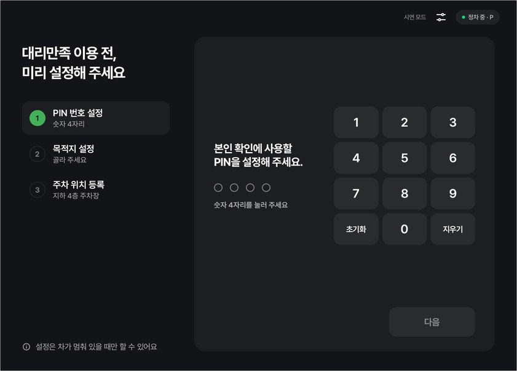
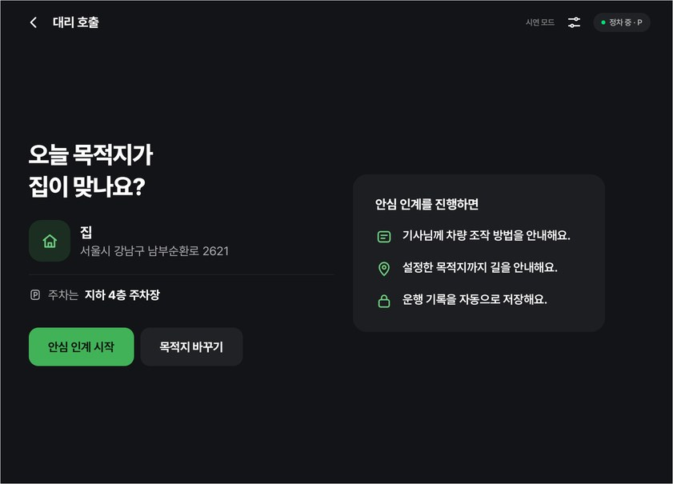
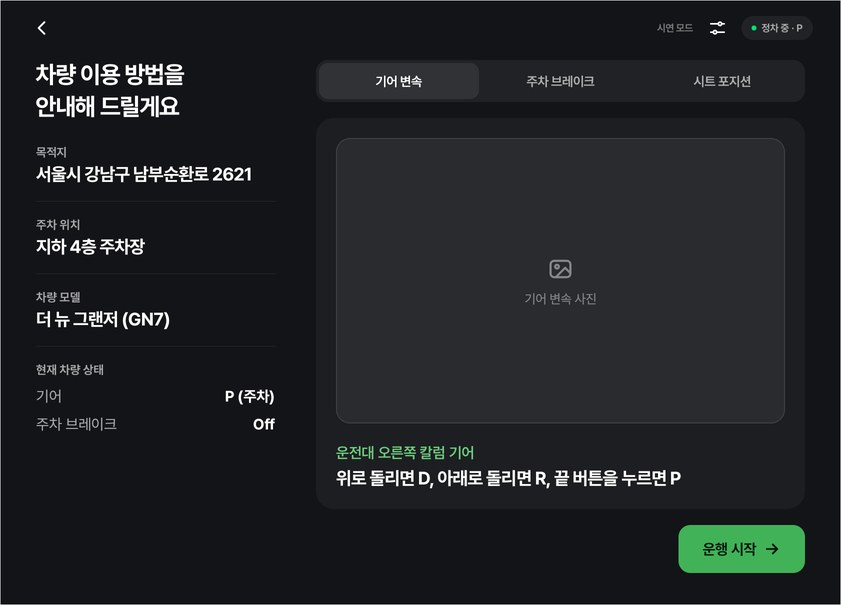
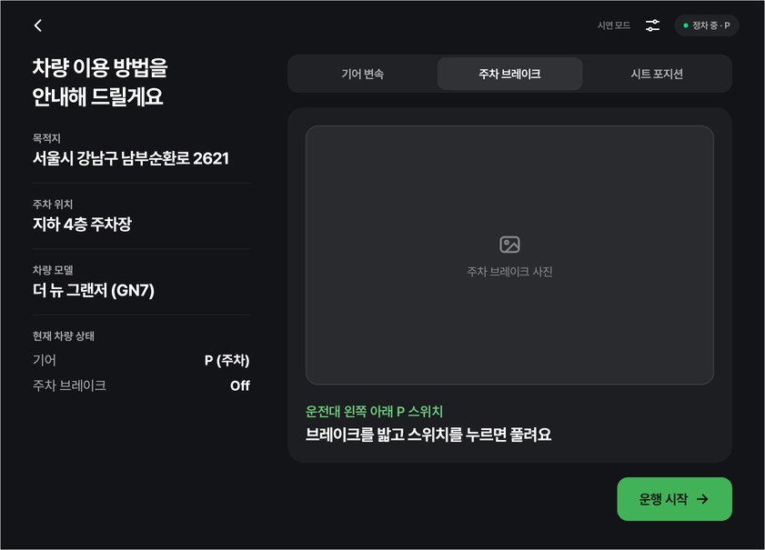
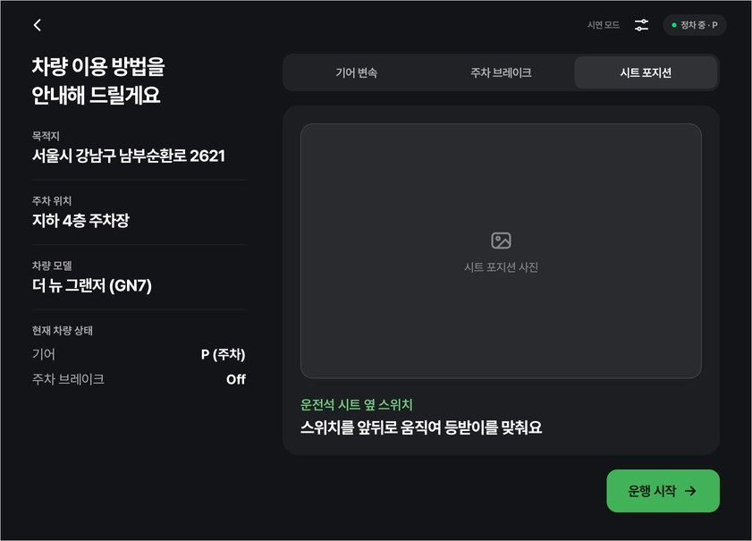
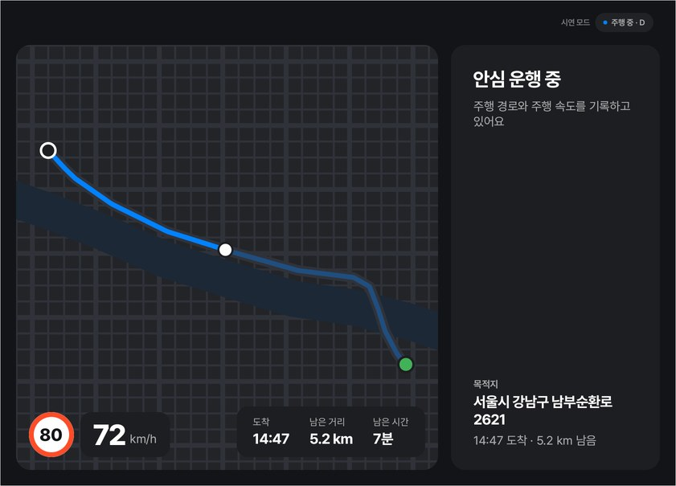
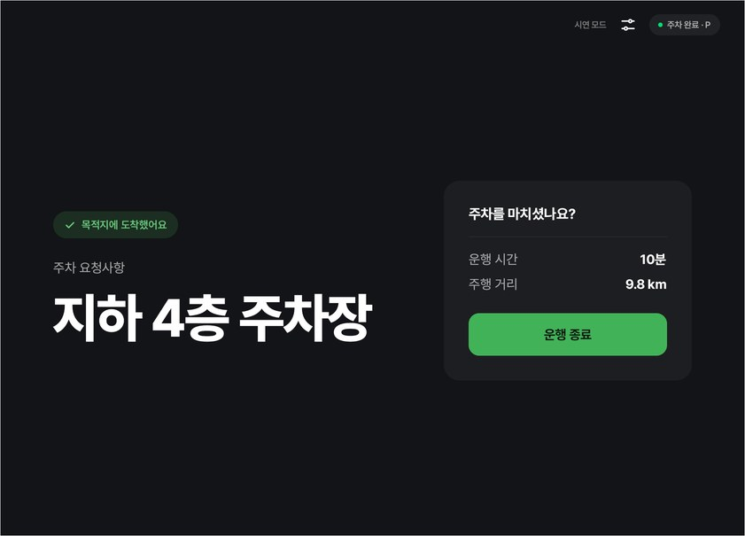
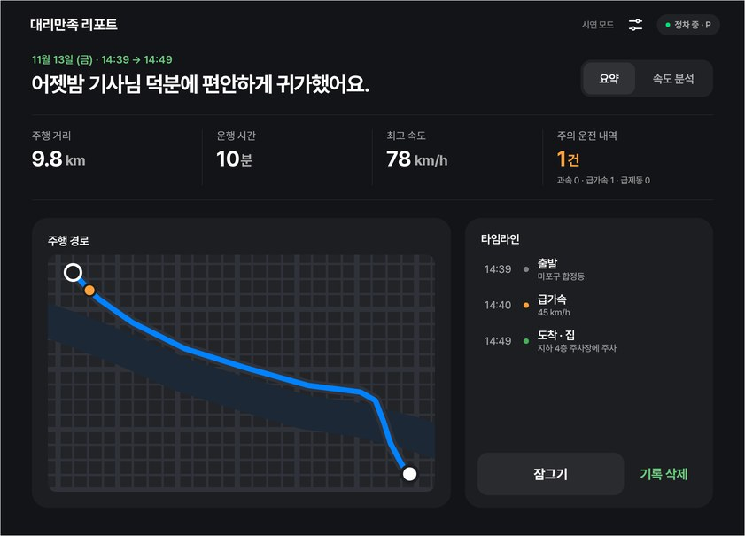
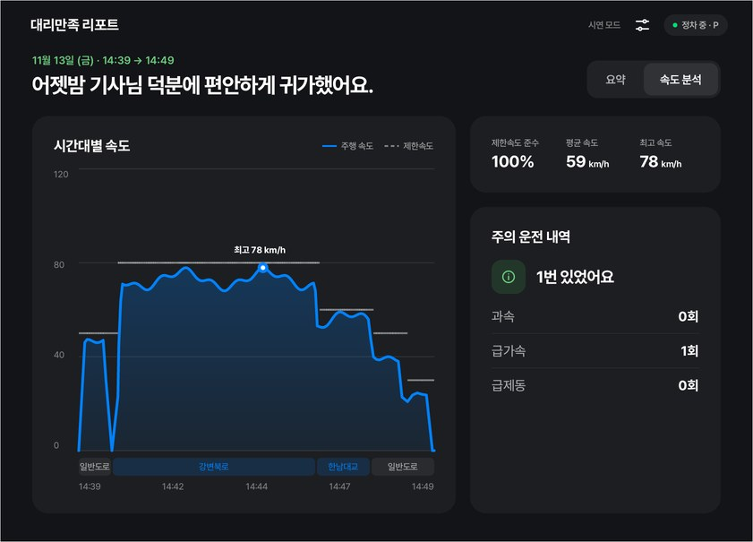
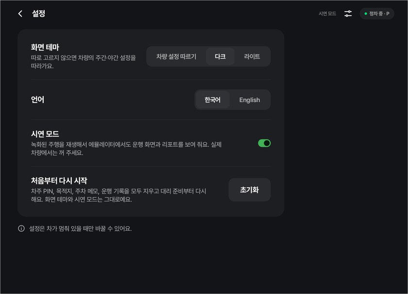

# 대리만족 (Daerimanjok)

**One tap hands your car to a designated driver, and gives you a full trip report when you get it back.**

In-car Android app for the **Pleos Connect** platform (Android Automotive OS 14).

| | |
| --- | --- |
|  |  |
|  |  |
|  |  |
|  |  |
|  |  |

Screens from the Pleos Connect emulator; the drive and report come from 시연 모드.

The control pictures in 차량 인계 come from the car's owner's manual, so they are not in this repository. Without them the app shows a placeholder, as in the 차량 인계 screenshots above. To use your own, add `tip_gear.jpg`, `tip_parking_brake.jpg` and `tip_seat.jpg` to `app/src/main/res/drawable-nodpi/`.

## How it works

| Step | Who | Screen |
| --- | --- | --- |
| S0 대리 준비 | owner, parked, once | 4-digit PIN → destination from the navigation app's bookmarks → parking spot, note, emergency contact |
| S1 대리 호출 | owner, parked | "오늘 목적지가 집이 맞나요?" → 대리 모드 시작 |
| S2 차량 인계 | driver, parked | destination, parking spot, live car status (battery/fuel, gear, parking brake, drive mode), control guide tabs (gear, parking brake, seat) → 운행 시작 starts navigation and recording |
| S3 안심 운행 | driver, driving | speed, speed limit, distance/time left, route sketch; no popups. Full-width layout, or one 840 column next to navigation |
| S4 차량 반환 | driver, on arrival | owner's parking spot in large type (+ heads-up notification if the app is behind navigation) → 운행 종료 locks the trip |
| S5 대리만족 리포트 | owner, parked, PIN | 요약 (distance, time, top speed, events, route, timeline) and 속도 분석 → 기록 삭제 |

Arrival comes from navigation (`onDestinationArrived`); a parked-only **도착했어요** button is the fallback.

**Recording.** Speed, speed limit (navigation), position (polled every 5 s), brake pedal, gear and
driver door feed a recorder that saves a route point every 10 s, every 50 m or on any event, in
batches every 30 s (Room). Events, all unit-tested in `record/EventDetector.kt`:
- **과속** more than 10 km/h over the limit for 3 s (110 km/h when the limit is unknown), one per episode
- **급가속 / 급제동** ±11 km/h within about a second (급제동 also needs the brake pedal when reported)

The owner setup (PIN hash and salt) is encrypted with an Android Keystore key. Measured on the
emulator while recording behind navigation: 0–2 % of one CPU core, ~90 MB memory.

**시연 모드** (Settings) replays a recorded-style Seoul drive (마포 → 강변북로 → 한남대교 → 강남, about 10 km,
10 min, played in about 30 s) through the same recorder, because the emulator's GPS doesn't move. It
has one red light, one 급가속 and no 과속. Real-car data is always the default.
Data never leaves the car. Settings (top-bar icon, parked only): theme (follow car / dark / light),
language, 시연 모드.

## Code map

```
app/src/main/java/app/daerimanjok/
├── feature/daeri/
│   ├── DaeriController.kt   setup + trip state machine IDLE → BRIEFING → DRIVING → ARRIVED → ENDED
│   ├── DaeriModels.kt       OwnerSetup, Place, DaeriTrip, DaeriPhase
│   ├── DaeriStore.kt        on-device persistence (survives app/emulator restart)
│   ├── CarGuide.kt          car model from the VIN → control tips (default: new Grandeur)
│   ├── TripStats.kt         TripAccumulator: distance, moving time, top speed, event counts (unit-tested)
│   ├── record/              EventDetector, TripRecorder (route points), TripDatabase (Room)
│   ├── demo/DemoDrive.kt    시연 모드 drive, simulated second by second
│   ├── RecordingService.kt  foreground service while recording; arrival notification
│   ├── Pin.kt               salted SHA-256 PIN hash (the PIN itself is never stored)
│   └── ui/                  S0–S5 screens, DaeriRoot (picks the screen from the phase)
├── core/
│   ├── vehicle/VehicleSource.kt   Pleos Vehicle SDK → odometer, brake, doors, fuel/battery, drive mode, VIN
│   ├── car/CarSource.kt           AAOS Car API → speed, gear, parking brake, CarUxRestrictions
│   ├── navi/NaviSource.kt         Pleos NaviHelper → bookmarks, routing, speed limit, distance left, arrival
│   ├── data/                      DataStore prefs + settings (theme, 시연 모드)
│   └── restrictions/DriveMode.kt  PARKED / DRIVING decision (unit-tested)
└── ui/                            theme (prototype tokens, Pretendard), components, settings, app shell
```

**Languages:** English and Korean (`res/values`, `res/values-ko`). The app follows the car's system
language, and Settings → 언어 overrides it per app (Android 13+), e.g. so the owner can pick the
driver's language. Add a language by copying `values-ko/strings.xml`
and adding it to `res/xml/locales_config.xml`.

Platform rules the app follows:

- **Driving vs parked** comes from `CarUxRestrictions` (gear is the fallback). Setup, briefing,
  report and settings are parked-only (`DmButton(parkedOnly = true)`); the report locks again if the
  car starts moving.
- Text input (parking note) only while parked; PINs use an on-screen keypad. Large touch targets.
- Only the permissions actually used are declared (see `AndroidManifest.xml`).
- Every car value can be *Unavailable*: the UI shows `n/a` instead of crashing.

## Requirements

- Android Studio (latest), JDK 17, Android SDK Platform 34 and 35
- Pleos Connect v2.1.0 system image + AVD with **Cold boot** (see `docs/DEV_NOTES.md`)
- A **Home** saved in the emulator's navigation app (navigation → 🏠 → search → 등록)

## Build and run

```bash
./gradlew installDebug          # build + install on the running emulator
./gradlew testDebugUnitTest     # unit tests (34)
```

## Demo scenario (Virtual Console)

```bash
adb forward tcp:8088 tcp:8088   # then open http://127.0.0.1:8088/
```

0. Optional: Settings → 시연 모드 on, to play the demo drive instead of driving with the console.
1. 대리 준비: PIN → 집 → parking spot → 설정 완료.
2. 대리 호출 → 대리 모드 시작 → 차량 인계 (live car status, control tabs) → 운행 시작.
   Navigation opens with the route home; switch back to 대리만족 for 안심 운행.
3. Console: **D** + hold **ACCEL**, then **BRAKE** and **P**.
4. 도착했어요 (the emulator's GPS doesn't move, so navigation never reports arrival) → 차량 반환 → 운행 종료.
5. 대리만족 리포트: PIN → 요약 / 속도 분석 → 기록 삭제.

## Release APK

1. Create a release keystore **once** and keep it outside the repo (never commit it):
   ```bash
   keytool -genkeypair -v -keystore ../release.jks -alias release -keyalg RSA -keysize 2048 -validity 10000
   ```
2. Create `keystore.properties` in the project root (git-ignored):
   ```properties
   storeFile=../release.jks
   storePassword=...
   keyAlias=release
   keyPassword=...
   ```
3. `./gradlew assembleRelease` → `app/build/outputs/apk/release/app-release.apk`

Without `keystore.properties` the release build is produced unsigned.

## SDKs

| SDK | Version | Used for |
| --- | --- | --- |
| `ai.pleos.playground:Vehicle` | 2.3.2 | odometer, brake, doors |
| `ai.pleos.playground:NaviHelper` | 3.0.5 | Home bookmark, route to Home, arrival events |
| AAOS `android.car` | platform | speed, gear, driving restrictions |
